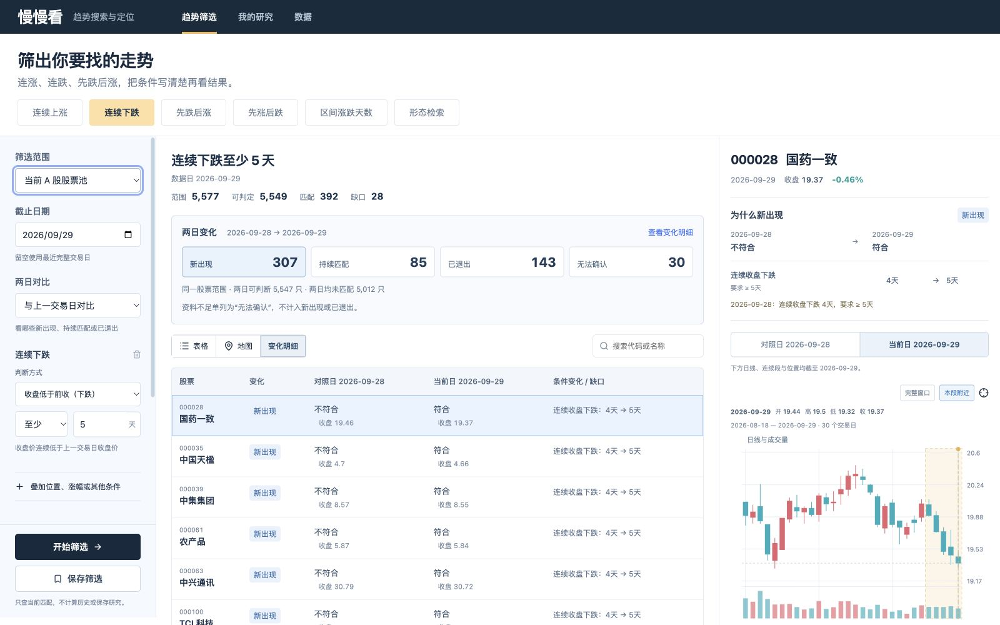

# 慢慢看 · manmankan

**A 股趋势筛选与位置研究工具。把“涨跌了几天、处在什么位置”变成可直接操作的条件。**

打开 `kan web`，选择连续上涨、连续下跌、先跌后涨、先涨后跌或区间涨跌天数，填写条件后查看当前匹配。点选结果，核对实际连续段、区间变化、多周期位置和日线；需要研究历史时再明确执行。



```bash
uv tool install manmankan
kan web
```

本机运行，无需注册慢慢看账号。也可以用 `kan tui` 直接输入条件筛选，或用 `kan trend` 和 MCP 编排。

## 直接回答这些问题

以下是明确输入的示例，产品不会默认替你填入天数或选择股票。

| 想观察的情况 | 表达方式 |
|---|---|
| 已连续下跌至少 5 天 | 连续下跌 · 至少 · 5 天 |
| 已连续上涨恰好 3 天 | 连续上涨 · 恰好 · 3 天 |
| 前一段连跌至少 3 天，随后连涨至少 2 天 | 先跌后涨 · 前段 3 天 · 当前 2 天 |
| 最近 10 个交易日中，上涨至少 8 天 | 区间涨跌天数 · 窗口 10 日 · 上涨至少 8 天 |
| 连涨条件下，还想限定长期位置或近期涨幅 | 展开位置与涨幅，叠加明确上下界 |
| 寻找类似某段走势的对象 | 选择参照股票、日期、形态窗口和允许距离 |

**收盘涨跌与阴阳线分别计算。** 收盘上涨比较前一市场交易日收盘，阳线比较当天开盘。平盘、十字线或缺行情会中断相应连续段；只能确认下界时显示“至少”，不会当作恰好 N 天。

## 从结果看懂走势

- 表格同时呈现当前连续段、本段价格变化、30/60/180 日位置和真实收盘小图；代码顺序不暗示优劣。
- 选中股票查看逐日价格、连续段起点、实际值与条件阈值，缺失值保持可见。
- 地图是同一批匹配对象的另一种视图，可切换坐标周期并用明确范围继续缩小条件。
- 每次结果都显示截止日、范围、可判断、匹配和资料不足数量；没有最新日行情时，可以明确选择本地主要数据日，不会悄悄替换日期。

## 保存条件，按需研究历史

“保存筛选”只保存名称与条件，可在 Web、TUI 或 Python 再次读取，不生成研究记录，也不自动获取行情。

“核对历史”带上原股票范围与条件，确认回看范围、事件采样方式和后续窗口后才运行。行业研究保留该行业全部成员，包含当前未命中与缺数据的对象。历史结果区分完整窗口、尚未成熟和行情缺失，并保存命中对象的当次行情与形态参照。

形态距离按两段收盘各自归一到首日 100 后计算均方根差，单位为百分点。固定参照不会随重跑漂移；使用已知形态搜索过去属于事后检索，不是事前策略回测。

## 终端与 AI

```bash
kan trend --universe all --down-days 5
kan trend --universe all --up-days 3 --comparison eq
kan trend --universe all --up-days 2 --previous-down-days 3
kan trend --universe all --rising-days 8 --window 10 --format json
kan trend --codes 600519,300750 --down-days 5 --save 连跌观察
kan tui
```

`--comparison` 支持 `gte`（至少）、`eq`（恰好）、`lte`（最多）；连续段的“最多 N 天”明确限定为 1–N 天。`--bull-days` / `--bear-days` 使用阴阳线口径。`kan trend --help` 给出完整条件与形态参数，MCP 的 `kan_trend` 使用同一个查询契约。

TUI 可直接填写条件、选择股票范围、执行当前筛选、查看日线和保存条件；历史研究单独确认，不必先去 Web 创建。

历史自动化使用 `kan study schema`、`kan study run query.json --format json` 与 `kan study rerun <study_id> --latest`。

## 数据与边界

- 只使用已完成的日线。当前上市名单和行业归属用于明确范围回溯，不冒充历史时点全市场。
- TuShare 单股与全市场使用原始日线和复权因子统一基准。旧的未验证缓存不参与计算，显式更新后重建；刷新失败保留已有有效文件。
- 自选、笔记、持仓、筛选与研究记录保存在本机。请求只向所选数据源发送必要代码与该来源凭据，持仓成本、股数和现金不发送。

详细语义见 [趋势筛选与研究](docs/trend-research.md)，安装和数据连接见 [快速开始](docs/china-quickstart.md)，程序接入见 [AI 使用说明](docs/ai-quickstart.md)。

## 开发

```bash
uv sync
npm --prefix webui ci
npm --prefix webui run build
uv run kan web
```

当前筛选、历史研究和各入口共用指标与连续段计算。SQLite 保存轻量状态，Parquet 保存行情与完整历史事件。**开发不做历史兼容**，删除无实际消费者的旧路径；数据资产与凭据仍受保护。验证重点是计算不变量、实际主路径与安装可用性，不设置测试数量或硬覆盖率目标。见 [架构](docs/architecture.md)。

Python 3.11+ · 本地运行 · [AGPL-3.0](LICENSE)

历史价格不预示未来；工具呈现事实与用户明确的研究条件，不提供买卖建议、目标价或收益承诺。
