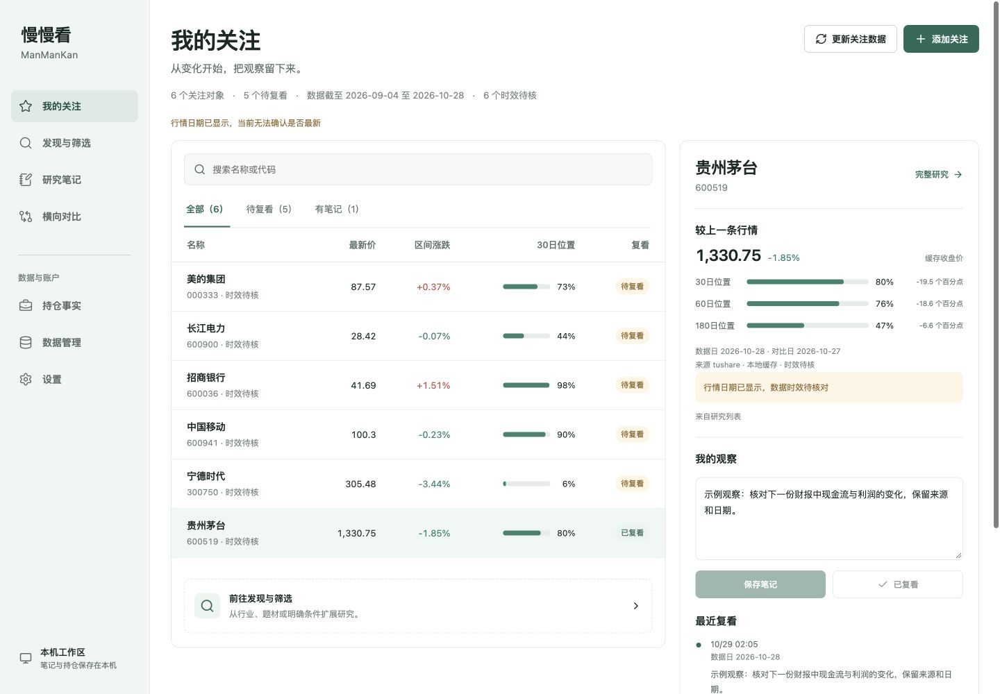

# 慢慢看 · manmankan

> **从变化开始，把观察留下来。A 股个人研究工作台。**
>
> 我的关注 → 核对变化 → 保存观察 → 连续复看。

[](https://www.gnu.org/licenses/agpl-3.0)
[](https://www.python.org/downloads/)
[](https://pypi.org/project/manmankan/)
[](https://pypi.org/project/manmankan/)
[](https://github.com/piklen/manmankan/actions/workflows/test.yml)
[](docs/compliance.md)
[](docs/china-quickstart.md)



慢慢看是一个**本地优先的 A 股个人研究工作台**。围绕一条日常路径组织功能：**看自己关注的对象有什么变化 → 核对数据 → 记下观察 → 下次继续复看**。

```bash
uv tool install manmankan
kan web                 # 浏览器研究桌面
kan tui                 # 键盘操作的终端工作台
```

- **我的关注**：已有自选、持仓和人工候选汇集到一处；直接读取本地行情，显示数据日、相邻行情涨跌、30/60/180 日区间位置及较上一条行情的变化。
- **连续观察**：选中对象即可保存笔记、标记已复看，回看当时的数据日、价格、位置和观察；筛选重跑不会冲掉人工记录。
- **按需扩展研究**：从“发现与筛选”查看行业/题材、历史事实或运行自己明确的条件，再把对象留在研究队列里。
- **同一份事实**：Web、TUI 和 Python 共用关注服务；原有 CLI、JSON、HTTP、MCP 继续用于精确查询、筛选和自动化。

首屏不自动抓取全市场。点击“更新关注数据”才会更新当前关注池；缺失、陈旧或无法确认新鲜度的数据会明确显示。空工作区从一个明确代码开始，不预置股票、条件或评分。

所有自选、持仓、笔记和缓存都保存在本机，不登录 manmankan 服务，不做云同步或遥测。查询行情时会向所选数据源发送股票代码；配置 TuShare 时，token 只发送到配置的数据源。持仓成本、股数和现金不会发送。

## 终端与 AI：按需获取研究证据

`kan research` 将明确股票代码的事实整理为同一份终端／JSON／MCP 研究包：

```bash
kan research 600519
kan research 600519 000858 --dimensions market,valuation,technical --format json
kan research 600519 --dimensions fundamentals --refresh --format json
kan research 600519 --dimensions income,balancesheet,cashflow --format json
```

默认提供市场、估值、财务三个维度，也可独立查询任一维度；只查财务不拉行情。财务缓存最多复用24小时，`--refresh` 立即检查来源，并分别返回报告期、公告日和检查时间。来源、单位、缺失和引用与数值一起返回；不调用模型，也不读取个人持仓。Python 使用 `build_research_bundle`，MCP 使用 `kan_research`。完整范围、部分失败与日期边界见 [`docs/research.md`](docs/research.md)。

按需加入 `income,balancesheet,cashflow` 可取得财报三表的28个关键金额科目，用于查看收入与利润、资产负债和现金流。三表分别保留日期，区分年初累计与期末余额；一张表缺失时仍保留其他表的材料。

## 每天如何使用

1. 打开 `kan web`，默认进入“我的关注”。已有对象直接出现；首次使用点击“添加关注”，填写明确股票代码。
2. 需要新数据时点击“更新关注数据”。只刷新当前关注池，进度和失败保持可见。
3. 选中一行，核对行情截止日、较上一条行情的区间位置变化；“完整研究”继续查看更多证据。
4. 写下需要继续核对的事实并保存笔记，核对完后标记已复看。下一次数据更新到新交易日，会重新显示待复看；历史记录仍保留。
5. 需要扩展范围时，进入“发现与筛选”。板块下钻只带入股票池，新建规则仍由你明确条件；筛选结果可保留为人工候选，也可建立横向对比。

终端使用 `kan tui`：方向键选择，`Enter` 查看详情，`/` 搜索，`a` 添加，`n` 写观察，`?` 查看全部快捷键，`Esc` 返回，`q` 退出。非交互脚本继续使用原有命令与 `--format json`。

完整的数据口径、复看行为和操作说明见 [`个人研究工作台`](docs/focus-workspace.md)。

## 进阶用户：CLI、JSON 与 AI

需要核对明确的日线交集和区间低点日期，可使用 [`kan screen ohlc`](docs/ohlc-screen.md)，保留统一复权基准、覆盖率及逐日证据。

Web、CLI、Python API 和 HTTP 共用 `BoardTrendQuery → BoardTrendSnapshot`；Web、Python API 和 HTTP 还共用 `BoardPulseQuery → BoardPulseSnapshot` 成员结构、`BoardDailyReview` 跨日复看和 `BoardHistoryStudy` 板块指数历史复核服务。Web、CLI、Python API、HTTP 和 MCP 也共用同一套 `ScreenSpec → ScreenRun` 服务。React 只负责交互和展示，不在浏览器重算金融事实；既有 `kan find` JSON 契约继续兼容。

```bash
kan screen filters --format json
kan screen save screen.json --format json
kan screen run <screen_id> --format json
kan screen versions <screen_id> --format json
kan screen runs <screen_id> --format json
kan scan --codes 600519,000858 --periods 30,60,180 --format json
kan range 600519 --format json
kan range --codes 600519,000858 --format json
kan find --codes 600519,000858 --format json --fields @core,@valuation,@moneyflow,@technical
kan mcp install --dry-run --format json
kan mcp http --host localhost --port 8765
```

`kan screen` 使用严格、版本化的领域契约；`kan find` 保持原有一次性查询入口。Screen 完整说明见 [`docs/selection-workbench.md`](docs/selection-workbench.md)，迁移与回滚见 [`docs/workspace-migration.md`](docs/workspace-migration.md)，AI 首用路径见 [`docs/ai-quickstart.md`](docs/ai-quickstart.md)。

## 从哪里继续

| 你是谁 | 先跑 / 先读 |
|---|---|
| 普通 A 股用户 | `kan web` / `kan tui`：个人关注、核对变化、观察笔记和连续复看 |
| 中国用户 / 开发者 | [`docs/china-quickstart.md`](docs/china-quickstart.md)：安装、行情源网络、TuShare、代理和 Windows / PowerShell |
| CLI / Python / HTTP 开发者 | [`docs/selection-workbench.md`](docs/selection-workbench.md)：同源领域模型、命令、Python API 与 `/api/v1` |
| AI agent / 自动化脚本 | `kan_screen_plan` + [`docs/ai-quickstart.md`](docs/ai-quickstart.md) + [`docs/mcp.md`](docs/mcp.md) |
| 第一次贡献者 | [`docs/contributor-quickstart.md`](docs/contributor-quickstart.md)：本地跑起来、验证命令、good first issue、合规边界 |

<details>
<summary><b>English summary</b></summary>

**manmankan** (*"take your time, see clearly"*) is a local-first personal A-share research workspace. Web and keyboard-driven TUI bring watchlists, holdings and manually retained candidates together with dated market facts, observation notes and review history. Industry discovery, explicit screening rules, immutable evidence and comparisons remain available. Shared Python services keep calculations consistent across interfaces.

Data, not decisions: no buy/sell advice, no ratings, no price targets. Python 3.11+ · local-first · A-share (architecture designed for multi-market extension) · [GNU AGPL-3.0](LICENSE).
</details>

## 为什么存在

很多选股流程的问题不在于缺少观点，而在于输入太散：自选股、行业成分、题材池、热榜、全市场截面、外部候选代码各有入口；行情位置、估值裸值、资金、技术指标、缺数据状态又分散在不同地方。

慢慢看把这些输入统一成一个可复核的数据层，并提供共用计算的研究入口：

- **个人研究桌面与终端**：从关注对象的变化进入研究，保存观察并持续复看。
- **CLI 与 AI 工具**：按问题取得研究证据、运行用户规则；JSON、Python API 和 MCP 调用共享服务。
- **Web 可视化**：提供板块趋势、成分股下钻、规则编辑、运行证据、候选研究、横向对比、数据更新和持仓视图。

如果你要让 AI 参与候选筛选，慢慢看的角色是提供可审计输入：它负责把"坐标"和"条件命中"说清楚，不负责替你下结论。

<details>
<summary><b>AI / 开发者能力</b></summary>

AI 与脚本通过稳定的机器契约取得和处理事实：

| 设计决策 | 说明 |
|----------|------|
| **JSON 是产品，不是后门** | `--format json` 输出包含 `ok`、`schema_version`、`query_time`、`data_availability`、`disclaimer`、`error` 信封——AI 不需要猜测字段含义或处理裸异常 |
| **低上下文成本** | `--compact` / `--fields @core` / `--agent-summary` / `--no-compact-context` 让 AI 按需索取，不浪费 token |
| **Schema 自发现** | `kan schema --format json` 返回 CLI JSON、find DSL、MCP tools 和错误 envelope 的机器可读契约；`--section find --compact` 可低上下文只取筛选契约 |
| **查询计划和 delta** | `kan find --dry-run` 预演数据源与高成本维度；`--snapshot` / `--since` 支持显式本地会话 delta |
| **示例可机器读取** | `kan examples --format json` 输出端到端命令清单，AI 可以先读示例再选择最短命令 |
| **Skills.md 能力清单** | [`skills/manmankan-skill.md`](skills/manmankan-skill.md) 是给 AI Agent 的"说明书"——AI 读到它就知道 manmankan 能做什么、怎么调、错误怎么处理 |
| **MCP Server** | `kan mcp serve` 提供 stdio MCP；`kan mcp http` 提供本机 Streamable HTTP endpoint；tools/list 暴露 `outputSchema`，tools/call 同时返回 text 与 `structuredContent`；接入细节见 [`docs/mcp.md`](docs/mcp.md) |
| **Typed Screen 生命周期** | `kan_screen_parse / plan / run / get / explain` 只整理、执行和解释 `ScreenSpec`，不让模型另造筛选算法 |
| **OpenAPI 生成前端类型** | `/api/v1/openapi.json` 是 HTTP SOT，TypeScript 类型由它生成并在 CI 检查 drift |
| **退出码即 API** | 每个命令的退出码有明确语义（0=成功，非 0=具体错误类别），AI 不需要解析 stderr 来判断成败 |

AI agent 首次接入推荐读 [`docs/ai-quickstart.md`](docs/ai-quickstart.md)。它把“查询计划 smoke”和“真实取数路径”拆开，避免把预演当成已经形成行情证据。

</details>

中国用户 / 开发者如果遇到 PyPI 下载慢、行情源网络、TuShare token、Windows PowerShell 或代理问题，先看 [`docs/china-quickstart.md`](docs/china-quickstart.md)。

## 快速开始

```bash
uv tool install manmankan
kan web
```

忘了命令直接跑：

```bash
kan guide
kan daily
kan help
```

终端常用入口：

```bash
kan scan                                      # 扫默认池（自选 ∪ 持仓）
kan screen filters                            # 查看 vNext 可用条件
kan screen save screen.json                   # 保存/版本化 ScreenSpec
kan screen run <screen_id> --format json      # 执行并保存不可变 ScreenRun
kan screen versions <screen_id>               # 查看规则版本
kan screen runs <screen_id>                   # 查看运行历史
kan scan --all                                # 扫 A 股全市场池（首次较慢）
kan scan --only-watchlist                     # 只扫自选
kan scan --exclude-star --exclude-bj          # 排除科创板 / 北交所
kan scan --codes 600519,000858               # 扫外部候选代码池
kan scan --periods 5,20,60,180 --wide         # 自定义 2-360 周期并全量展示
kan info 600519                               # 单股详情 + 所属行业位置均值/排名对照
kan range 600519                              # 复核历史日内上下行范围，默认看 5/15 日与四档分位
kan range --codes 600519,000858               # 多股逐一复核，保留四档和触及后结果
kan range 600519 --down 3 --up 7              # 复核用户明确给出的 -3% / +7% 阈值
kan find --codes 600519,000858 --format json --dry-run # 不取数的查询计划 smoke
kan find --codes 600519,688981 --format json --fields @core,@retail
kan find --codes 600519,688981 --format json --fields @core,@valuation,@moneyflow,@technical
kan scan --codes 600519,000858 --format json # 拉公开日 K 的真实坐标 JSON
kan find --all --pe lt:20 --format json --compact
kan trend --all --down 3                      # 全市场连续下跌看板
kan board trend --kind industry --up 3        # 连续上涨 ≥3 天的申万行业指数
kan board trend --kind theme --up 3           # 连续上涨 ≥3 天的概念题材指数
kan board trend --kind theme --up 3 --candle  # 连续 3 根阳线的概念题材指数
kan fetch --all --workers 12                  # 批量并发刷新全市场 360 日 K 线缓存
kan hold cash 50000                           # 录入现金,用于展示一手占现金比例
kan hold add 600519 --cost 1680 --shares 100 # 手动录入真实持仓事实
kan hold                                      # 持仓盈亏 + 仓位 + 位置总览
kan hold --format json --mask                 # AI/脚本消费；金额脱敏
kan board rank --kind industry --by moneyflow --format json
kan history 600519 --format json
```

板块趋势有两个明确口径：默认“今日收盘 > 前日收盘”计连续上涨，`--candle` 则按“当日收盘 > 当日开盘”计连续阳线。`kan theme trend` 继续作为旧题材入口兼容；新脚本统一使用 `kan board trend --kind industry|theme`。

`kan scan` / `kan daily` 面向终端阅读；`kan find --format json`、`kan hold --format json` 和 MCP 面向脚本与 AI 消费。

`kan range <股票代码>` 回答：过去有几天到过某个日涨跌幅，到过之后收盘有没有收回或守住？无需先填写幅度，默认比较近 **5/15 个完整交易日**、**75/85/90/95 四档**。终端按下跌、上涨分为两表，同档的 5 日与 15 日相邻；每行依次是幅度与折算价、到过天数/窗口样本、触及后的收盘次数与比例。`1/1 次（100%）` 只是一例，不代表未来把握；没有触及则明确显示无样本，不当作零概率。

已经有想核对的幅度时，运行 `kan range 600519 --down 3 --up 7`：开头先逐窗口回答用户输入的 `-3%/+7%`，再给完整四档对照。3/7 仅演示参数写法，不是工具选择的阈值；可填 `0`，省略表示不请求该方向。日涨跌幅相对每日前收，不是持仓盈亏。

`kan range --codes 600519,000858` 可一次复核最多 20 只股票，按输入顺序逐股展示**全部请求档位、周期与收盘结果**，不再隐藏 75/85 档或批量的条件结果；公共读法与小样本提示只显示一次。批量也可以加 `--down/--up`，无需逐股重跑。完整阅读示例见[中国用户快速开始](docs/china-quickstart.md#日涨跌幅历史复核)。

口径：下跌线的“收回”是收盘高于该线，“收涨”是收盘高于当日前收，二者有重叠；上涨线的“守住”含收盘等于该线，“未守住”是收盘低于该线。档位是线性插值分位，“未越”是没有越过幅度的样本比例；恰好到线同时计入未越和触及，两者不一定互补。短窗口包含在长窗口内，不是独立样本。日 K 不能还原盘中先后或水下时长。

每条幅度线的 `reference_price` 使用**本次数据截止日的参考收盘**折算，按 0.01 元价格档 `ROUND_HALF_UP` 输出两位，不是历史事件价、实时价或成交保证，跨日需重算。`threshold_pct` 是分类采用的 4 位公开阈值，终端保留相同精度，可原样回传 `--down/--up` 复核相同证据。收盘中位、最高到收盘回落等明细仍在 `--format json` 中。单股 JSON 为 `study`，批量为 `studies/errors/partial`；逐股失败保留成功结果、顶层 `error` 与非零退出码。工具不输出止损/止盈推荐，也不预测未来涨跌。

## 数据契约

慢慢看的核心输出不是"推荐"，而是可组合的数据事实。

主要能力：

- 选股领域对象：版本化 `Screen`、不可变 `ScreenRun`、独立 `CandidateList`、3–10 股 `CompareSet`。
- 运行审计：规则/结果哈希、数据截止日、覆盖率、缺字段计数、逐条件证据、来源和相邻运行 diff。
- 多周期位置百分位：3 / 5 / 7 / 10 / 15 / 30 / 60 / 90 / 120 / 180 日。
- 共振：同一候选在多个周期同时接近低位或高位。
- 散户事实：一手金额、占已录入现金比例、科创/北交/创业板权限提示、距区间高低点距离、量价方向组合。
- 候选池：自选、行业、题材、热榜、完整 A 股市场（含北交所 / ST）、外部 `--codes` 或 stdin。
- 真实持仓：用户在 Web 或 CLI 录入成本 / 股数 / 现金，本地计算市值、仓位、今日和累计盈亏。
- 筛选条件：位置、共振、涨跌、连阳连阴、估值、质量、资金、技术指标、筹码、股东、除权除息事件等。
- 板块指数：行业 / 题材区间涨幅、位置、资金榜，以及按收盘价或阳线阴线口径计算的连续涨跌榜；板块与股票复用同一 streak 算法。
- 输出形态：React Web、终端表格、Markdown、JSON、紧凑 JSON、字段白名单、Python API、typed HTTP 与 MCP。

JSON 相关入口：

```bash
kan schema --format json --section find --compact
kan find --industry 半导体 --format json --fields @core,@valuation
kan find --codes - --format json --compact
kan find --codes 600519,000858 --format json --agent-summary
kan find --codes 600519,000858 --format json --snapshot
kan find --all --format json --compact --no-compact-context
kan scan --all --format json
```

机器可读 schema 先看 `kan schema --format json`；完整 `kan find` 字段分组、`data_availability`、缺数据语义、错误 envelope 见 [`docs/find.md`](docs/find.md)。脚本化入口以 [`kan/api.py`](kan/api.py) 文件头 docstring 为公开 contract。

## 安装

要求 Python 3.11+。推荐用 [uv](https://docs.astral.sh/uv/)：

```bash
uv tool install manmankan
kan --version
```

其他方式：

```bash
pipx install manmankan
python3 -m venv ~/.kan-venv && source ~/.kan-venv/bin/activate && pip install manmankan
git clone https://github.com/piklen/manmankan.git && cd manmankan && uv sync && uv run kan --version
```

如果装完当前终端找不到 `kan`，打开新终端让 PATH 生效。国内镜像源同步慢时，可以临时直连 PyPI：

```bash
uv tool install manmankan --index-url https://pypi.org/simple/
```

## 市场覆盖

**当前专注 A 股。** 数据源适配层为多市场扩展设计——美股、港股、加密货币等市场可以作为独立 Source 接入，共享同一套 CLI 命令语义和 JSON schema。详见 [`docs/architecture.md`](docs/architecture.md)。

## 边界

慢慢看不会做这些事：

- 不推荐具体股票。
- 不预测涨跌。
- 不给买卖建议、评级、目标价或仓位建议。
- 不内置策略 preset、打分模型或"最佳标的"排序。
- 不下单、不接券商账户、不自动读取外部持仓；真实持仓只来自用户在 Web 或 CLI 主动录入的本地 XDG 数据。
- 不提供实时行情推送、分钟级行情、港股、美股、期货或完整财报数据库（多市场是远期路线图，当前仅 A 股）。
- 不内置模型 provider 或托管 AI 服务；typed AI/MCP adapter 只整理明确规则、调用确定性服务并引用已有证据。

位置百分位的定义是：

```text
(当前价 - N 日最低价) / (N 日最高价 - N 日最低价) * 100
```

`0%` 表示 N 日区间最低，`100%` 表示 N 日区间最高。共振 `×N` 表示多个周期同时接近低位或高位。它们只是坐标，不是信号。合规细则见 [`docs/compliance.md`](docs/compliance.md)。

## 隐私与数据

慢慢看本地运行：

- 工作台状态存放在 `~/.local/share/kan/workspace.sqlite3`（WAL）；行情继续使用 Parquet，二者都按 XDG 规范管理。
- 旧 `config.json`、`watchlist.json`、`positions.json` 首次接管前保留不可覆盖的 `.vnext-backup`；可用 `kan workspace rollback --yes` 导出当前值并切回 JSON。
- 数据目录权限收紧为 `0700`，数据库、备份和敏感状态文件为 `0600`。
- `kan web` 每次启动生成随机会话凭证；页面、API 和数据更新事件都要通过本次浏览器会话访问。
- 持仓输出可加 `--mask` 脱敏金额；本地数据仍可能被 Time Machine / iCloud 等系统备份工具复制。
- 不需要登录，不上传自选股，不做遥测。
- CLI 会访问公开行情数据源；更新检查会访问 PyPI，可用 `KAN_NO_UPDATE_CHECK=1` 关闭。
- 配置 TuShare token 后，token 只发往你配置的 TuShare API 端点。
- `kan uninstall` 会清理本地数据并提示对应的软件包卸载命令。

本项目代码和文档使用 [GNU AGPL-3.0](LICENSE)（`AGPL-3.0-only`）。如果你修改本项目并通过网络服务提供交互，需要按 AGPL 向用户提供对应源代码。市场数据主要来自 AKShare 生态及公开行情源，可用性依赖上游；第三方行情数据、API、SDK 和 TuShare Pro 权限不由本项目授权，使用时仍需遵守对应上游条款、额度和合规要求。

## 文档导航

| 文档 | 用途 |
|---|---|
| [`CHANGELOG.md`](CHANGELOG.md) | 版本变更记录 |
| [`docs/architecture.md`](docs/architecture.md) | 架构愿景：三层定位、Source 模型、多市场路线、AI 消费设计 |
| [`docs/selection-workbench.md`](docs/selection-workbench.md) | vNext 当前架构、四领域对象、Web / CLI / Python / HTTP / MCP 使用契约 |
| [`docs/workspace-migration.md`](docs/workspace-migration.md) | SQLite 状态迁移、备份、幂等、诊断与回滚手册 |
| [`docs/china-quickstart.md`](docs/china-quickstart.md) | 中国用户 / 开发者首用路径、国内网络、PyPI 镜像、TuShare 与代理排查 |
| [`docs/contributor-quickstart.md`](docs/contributor-quickstart.md) | 首次贡献路径、good first issue、验证命令和 AI 协作边界 |
| [`docs/ai-quickstart.md`](docs/ai-quickstart.md) | AI agent 首用路径、JSON / MCP 消费规则 |
| [`docs/mcp.md`](docs/mcp.md) | MCP 支持客户端、dry-run、写入规则和 agent 解释边界 |
| [`docs/find.md`](docs/find.md) | `kan find` JSON schema、字段、缺数据语义 |
| [`docs/compliance.md`](docs/compliance.md) | 合规边界、公开输出语言规范 |
| [`docs/roadmap.md`](docs/roadmap.md) | 路线图和明确不做的方向 |
| [`skills/manmankan-skill.md`](skills/manmankan-skill.md) | AI Agent 能力清单（给 AI 读的说明书） |
| [`AGENTS.md`](AGENTS.md) | AI 编程助手进入本仓库时的开发边界和验证命令 |
| [`SUPPORT.md`](SUPPORT.md) | 支持范围、Discussions / Issues 分流和安全报告入口 |
| [`kan/api.py`](kan/api.py) | Python API 公开 contract |
| [`SECURITY.md`](SECURITY.md) | 安全与漏洞报告 |
| [`CONTRIBUTING.md`](CONTRIBUTING.md) | 开发、测试、贡献规范 |

## 开发

```bash
git clone https://github.com/piklen/manmankan.git
cd manmankan
uv sync
npm --prefix webui ci
uv run ruff check kan/ tests/
uv run mypy
uv run pytest -q -m "not network and not tty"
npm --prefix webui run check
npm --prefix webui test
npm --prefix webui run build
```

启用本地 hooks：

```bash
git config core.hooksPath .githooks
```

第一次贡献先读 [`docs/contributor-quickstart.md`](docs/contributor-quickstart.md)，也可以先从 [`good first issue`](https://github.com/piklen/manmankan/issues?q=is%3Aissue%20is%3Aopen%20label%3A%22good%20first%20issue%22) 开始；贡献规范详见 [`CONTRIBUTING.md`](CONTRIBUTING.md)，尤其是公开输出的中性语言和合规边界。

## 许可证

[GNU AGPL-3.0](LICENSE) · © 2026 piklen

你可以在 `AGPL-3.0-only` 条款下使用、修改和分发本项目代码。修改版本、二次分发和网络服务使用需遵守 AGPL 的源码提供和同许可要求。项目许可证只覆盖本仓库的代码与文档，不替代第三方行情数据、API、SDK 或投资合规义务。

Bug / 功能反馈走 [GitHub Issues](https://github.com/piklen/manmankan/issues) 或 [Discussions](https://github.com/piklen/manmankan/discussions)。
贴日志前先看 [安全反馈说明](docs/china-quickstart.md#8-反馈问题时请带上这些信息)，脱敏 token、代理账号、本机路径和持仓金额。
