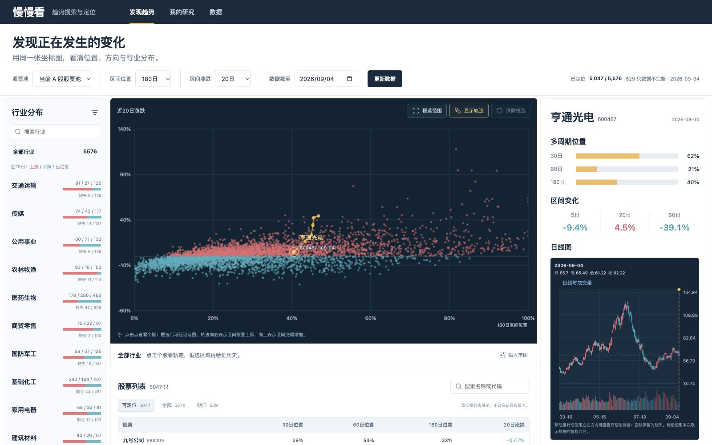

# 慢慢看 · manmankan

**A 股趋势搜索与定位工具。发现变化，判断位置，再核对历史证据。**

慢慢看把全市场放在同一张坐标图上：横轴看长期区间位置，纵轴看近期涨跌；选中股票看它怎样移动，切换周期看短期变化与长期位置的关系。行业成员分布、明确条件和历史样本在同一条研究路径里联动。



```bash
uv tool install manmankan
kan web
```

浏览器只连接本机服务。也可以运行 `kan tui`，用键盘浏览趋势与已保存研究；AI 和脚本使用 `kan study` 的结构化输入与输出。

## 用它完成什么

### 1. 找到变化发生在哪里

“发现趋势”显示同一截止日的股票分布。按当前 A 股、个人池或明确代码观察，切换 30/60/180 日位置和 5/20/60 日变化。行业列表显示对应区间内上涨、下跌成员的分布；点击行业后，地图与列表一起缩小范围。

点选一只股票，可以看到多周期位置、区间变化、位置轨迹和实际日 K。轨迹向右表示区间位置上移，向上表示所选区间涨幅增加；它们不表示未来走势。

### 2. 把看到的区域变成明确条件

在地图上框选区域，或直接填写坐标边界。页面展示完整条件和对象数量，确认后进入研究验证。同一位置与涨跌公式同时用于地图、当前匹配和历史事件，避免在几个功能之间手工重新拼条件。

默认没有框选区域、条件组合、股票推荐或综合评分。缺数据的对象计入分母，不画成零值，也不把不同日期的行情混成同一张当前图。

### 3. 按一段实际走势寻找相似样本

选定股票与日期后，可以用它的一段收盘走势作为参照，明确窗口和允许距离，检索当前与历史样本。

形态距离是两段价格各自归一到首日 100 后的均方根差，单位为百分点。它衡量形状差异，不是投资评分。用后来选出的形态回看过去属于事后检索，不构成事前策略回测。

### 4. 核对这种情况过去怎样

一份研究同时包含“当前匹配”和“历史验证”。历史结果给出可评估股票日、原始条件命中、采样事件、完整后续窗口、尚未成熟和缺行情的样本数。点击某次事件，查看当时的 K 线、条件实际值、观察区间和来源。

运行自动保存。命中对象的当次行情、形态参照与完整事件保留在本机；之后更新缓存，不会改写旧研究的图证。“更新至最近收盘”明确推进日期，比较当前匹配新增、移出和数据不可用；固定历史日期仍可按原日复算。

## 数据和范围

- 当前研究使用已完成的日线，支持价格、位置、连续关系、成交量和形态条件；不把分钟问题伪装成日线可回答的问题。
- 全市场范围来自当前上市名单；历史分析明确是当前股票池的回溯，不能冒充历史时点全市场。
- 行情依赖已配置来源及本地缓存。需要数据时显式更新当前研究范围；代码池不会扩大成全市场请求。
- TuShare 日线按原始价格与复权因子统一基准。以前逐日拼接且没有基准证据的缓存不参与新计算，更新行情后重建。
- 自选、候选笔记、持仓、配置与研究记录保存在本机；不登录慢慢看服务，不做云同步或遥测。查询只向所选数据源发送必要代码与该来源凭据，持仓成本、股数和现金不发送。

详细口径见 [趋势与研究](docs/trend-research.md)，安装和数据连接见 [快速开始](docs/china-quickstart.md)。

## 终端与 AI

```bash
kan tui
kan study catalog
kan study schema
kan study run query.json --format json
kan study list --format json
kan study show <study_id> --format json
kan study rerun <study_id> --latest --format json
```

`kan study schema` 给出当前查询格式，`catalog` 给出字段的中文定义和单位。条件与数值由调用者明确提供；不让模型重算行情或用模糊描述猜阈值。

TUI 使用 `t` 查看个人池趋势、`a` 查看全市场、`l` 打开研究，Enter 查看事实，`1/2` 切换当前与历史结果，`n/p` 翻页，Esc 返回，`?` 查看帮助。

按需精确取数的 CLI / Python / MCP 能力仍可使用：

- [`kan research`](docs/research.md)：行情、估值、财务和三表证据。
- [`kan find`](docs/find.md)：显式条件筛选与机器可读输出。
- [`kan screen ohlc`](docs/ohlc-screen.md)：固定复权基准的日线交集。
- [`kan range`](docs/china-quickstart.md#日涨跌幅历史复核)：日内范围的历史事实。
- [AI 接入](docs/ai-quickstart.md)与[MCP 接入](docs/mcp.md)。

## 开发

```bash
uv sync
npm --prefix webui ci
npm --prefix webui run build
uv run kan web
```

共享 Python 指标计算支撑地图、研究、Web、TUI 和 CLI；SQLite 保存研究索引，Parquet 保存行情与完整事件。没有单独 AI 服务或第二套前端计算内核。

开发按当前目标直接更新契约，**不做历史兼容**。旧 HTTP 路径、参数别名和界面不作为新实现负担；已有用户数据与凭据仍受保护。验证以核心计算不变量、真实主路径和安装可用性为准，不以测试数量、文件拆分或覆盖率数字衡量质量。见 [架构](docs/architecture.md)与[贡献说明](CONTRIBUTING.md)。

Python 3.11+ · 本地运行 · [AGPL-3.0](LICENSE)

历史价格不预示未来；工具呈现事实与用户明确的研究条件，不提供买卖建议、目标价或收益承诺。
