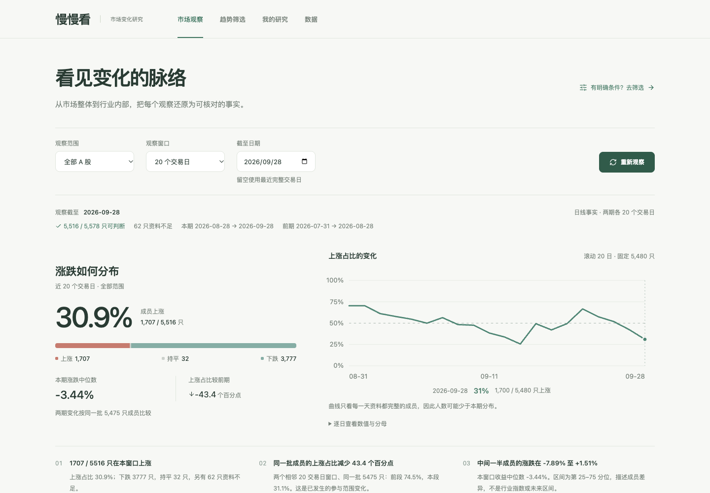

# 慢慢看 · manmankan

**从数据中看见市场的变化，并把每个观察追溯到证据。**

慢慢看是本机运行的 A 股市场研究工具。打开后先看群体：涨跌是否普遍、行业内部如何分化、前后两段的参与范围发生了什么变化。再点进分布、成员与日线，把观察变成自己的问题。



## 安装与主线体验

普通使用安装 **PyPI 已发布稳定包**；其功能以对应的 [发布说明](https://github.com/piklen/manmankan/releases) 为准：

```bash
uv tool install manmankan
kan web
```

本文介绍 **`main` 主线的市场观察与观察笔记**。主线可能先于 PyPI 公开发行；稳定包尚未包含这些能力时，可明确切换到 Git 主线体验（需要 Git）：

```bash
uv tool install --force "git+https://github.com/piklen/manmankan.git@main"
kan web
```

该命令将本机 `kan` 切到主线构建。用 `kan --version` 核对实际安装版本；主线合并与 PyPI 公开发布是两个独立步骤。

无需注册慢慢看账号。行情使用你配置的数据源，本机保存个人资料与研究。首次没有行情时，可在数据页配置自己的来源，再按原观察范围和所需日期准备数据；完成后回到同一次观察。旧行情会标出真实日期。

## 从一个现象开始

| 想弄明白什么 | 在慢慢看里怎么做 |
|---|---|
| 这段时间的变化有多普遍？ | 看完整范围的上涨/下跌/持平数量、中位数和收益分布 |
| 是整个市场在变化，还是集中在某些行业？ | 展开行业剖面，比较各自的参与比例、分布和资料覆盖 |
| 变化持续了吗？ | 看固定同一批成员的滚动窗口轨迹，逐日展开数值和分母 |
| 前期和本期发生了什么变化？ | 比较两个相邻等长窗口，查看两段均涨、方向切换、两段均跌与未知成员 |
| 这个观察能否经得起核对？ | 点击分布或变化分组，下钻全部成员，再查看同一截止日的真实日线 |

默认观察窗口为 20 个市场交易日，可改为 5 日或 60 日。它定义统计尺度，没有替你挑选股票、设置组合条件或评分。行业与成员按名称/代码排列，分组下钻必须由你明确选择。

**分母是认识的一部分。** 当前分布使用本窗口完整成员；两段变化只比较两段均完整的同一批成员；历史轨迹又采用每个点均有完整窗口的固定成员。三者分别标明数量，缺失不算下跌或持平。中位数是成员等权的统计量，不是行业指数收益。

## 留下一个观察，下次再核对

在完整范围或行业剖面点击“记下这个观察”，写下标题和可选的想法。当时的群体统计与全部成员事实一起保存在“我的研究”；当前分组和名称搜索不会悄悄缩小保存范围。

下次打开可以直接读原事实。明确点击复看后，工具保持原成员代码和观察窗口，比较两次都完整的同一批成员。原想法与原事实不被覆盖；资料缺失仍是未知。这样能核对“我当时看到了什么、现在发生了什么变化”，而不把回看结果误当因果或预测能力。

## 从观察继续验证

观察页可以带着完整范围和截止日进入趋势筛选。你明确填写连续涨跌、阳阴线、位置、波段结构或形态参照后，工具才判断哪些成员满足。筛选表格、地图与逐日证据共用计算。

- 连续段区分收盘高于前收与收盘高于开盘，平盘、十字与缺行情会中断相应序列。
- 波段按可调的收盘反向幅度确认，区分转折发生日、确认日与当前未完成段。
- 两日对照区分新出现、持续、退出与无法确认，不把资料丢失当成退出。
- 保存筛选只保存名称与条件；明确核对历史时，才计算事件并保存当次价格证据。

完整口径见[市场观察、趋势筛选与研究](docs/trend-research.md)。

## 终端、Python 与 AI 同源

```bash
kan discover                                  # 完整范围的市场观察
kan discover --window 5 --industry 通信          # 明确观察窗口与行业
kan discover --as-of 2026-09-29 --format json    # 指定历史日，不冒充今日
kan tui                                       # 键盘观察与研究
kan trend --universe all --up-days 3             # 明确条件后筛选
kan study run query.json --format json          # 明确历史研究契约
kan observe list --format json                 # 已保存的观察
kan observe review <观察ID> --format json        # 显式复看原成员
```

```python
from kan.api import DiscoveryQuery, discover_market

result = discover_market(DiscoveryQuery(window=20))
print(result.market.observations)
```

MCP `kan_discover`、HTTP `/api/v1/discovery`、CLI 和 Python 返回同一份群体统计、成员和覆盖。`kan_trend` 与 `kan study` 分别负责明确条件与历史验证；不另外维护 AI 推断的股票结论。

## 数据与使用边界

- 仅使用已完成日线。当前上市名单、当前行业归属用于回溯，不能冒充历史时点全市场。
- 日线按统一复权基准计算；缺失市场交易日不跳过、不填零。数据更新失败保留已有有效文件；短窗口刷新保留已有较长历史，不拼接不同复权基准。
- 无最新日行情时，页面提供显式选择本地主要数据日的操作，不静默改日期。
- 自选、笔记、持仓、命名条件和研究留在本机。数据请求只向所选来源发送必要代码及其凭据，不发送持仓成本、股数或现金。
- 工具描述已发生的事实，不提供股票评级、买卖动作、价格目标或未来概率。历史价格不预示未来，不构成投资建议。

安装与数据连接见[快速开始](docs/china-quickstart.md)，程序接入见[AI 使用说明](docs/ai-quickstart.md)。

## 开发

```bash
uv sync
npm --prefix webui ci
npm --prefix webui run build
uv run kan web
```

Python 模块化单体，一套计算核心，多入口薄适配；SQLite 保存用户状态，Parquet 保存行情与显式研究证据。先验证受影响事实与用户主路径，CI 执行一次集成检查；不设硬覆盖率或实现形状门禁。详见[贡献说明](CONTRIBUTING.md)与[架构](docs/architecture.md)。

GNU AGPL v3，详见 [LICENSE](LICENSE)。
