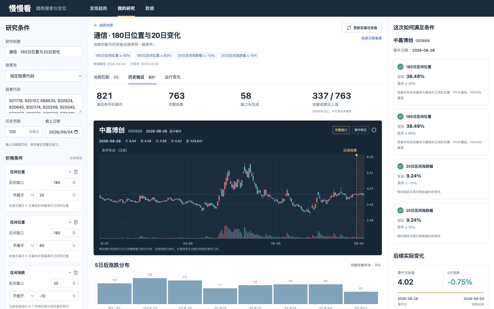

# 趋势发现与研究验证

## 从地图开始

`kan web` 默认打开趋势地图。选择股票池、截止日、位置窗口与涨跌窗口后，所有可绘制对象使用同一日期。横轴是收盘在最近 N 日最高/最低价之间的位置，纵轴是相对 N 个市场交易日前收盘的涨跌。

常用位置窗口为 30/60/180 日，涨跌窗口为 5/20/60 日。它们及各期轨迹由同一次服务计算返回，切换显示不重新扫描全市场。行业面板的上涨/下跌家数对应所选涨跌窗口，并保留总数与可定位分母。

缺少完整窗口、截止日行情或本地缓存的股票计入缺口；不会用另一日期的数据代入，也不会填成 0。当前 A 股身份来自当前上市名单，行业归属也是当前口径。

TuShare 日线使用原始 `daily` 与 `adj_factor`，同一股票的整个窗口按同一截止日因子计算复权价格。旧的逐日 qfq 拼接缓存缺少统一基准，不继续读取；显式更新行情后重建，已有研究、持仓和凭据不会因此删除。

## 圈定区域，形成研究

桌面可以显式进入框选模式；手机或键盘用户可以直接填写坐标上下界。页面清楚列出位置、区间涨跌和股票范围，确认后转为 `StudyQuery`。行业选区包含该行业的范围，不只留下恰好有数据的对象。

默认不建立条件组合。条件字段、窗口、比较符和数值必须明确，全部条件按 AND 组合。`kan study catalog` 给出实时字段与定义，`kan study schema` 给出完整输入契约。

位置与收益来自同一 `calculate_metrics`；前端不通过自己的公式重新判断匹配。

## 当前与历史是同一个问题



运行后同时取得：

- 指定截止日的当前匹配，以及因资料不足无法判断的对象。
- 历史股票日的可用、可评估与原始命中数量。
- 按首次满足、每次满足或不重叠规则选出的事件。
- 事件后观察窗口完整、尚未成熟、应有行情缺失三类数量。
- 完整样本的实际涨跌分布、分位与逐事件证据。

“首次满足”需要前一个市场交易日明确不满足；缺行后不能凭空断言出现了一次新事件。连续段在数据开头或缺口后可能只知道长度下界，此时不能据此断言“恰好 N 天”。

后续窗口按市场交易日定位，停牌或缓存缺行不会被压缩成连续行情日。完整统计基于全部事件；列表分页不会改变统计分母。

## 形态检索

参照来自用户明确选择的股票、日期与窗口。每段收盘序列按首日归一到 100，形态距离为对应各日差的均方根，单位是百分点。阈值由用户填写，不内置“最好股票”评分。

参照窗口与候选窗口都必须完整。同股票、同日期的自匹配单列排除。参照行情随运行保存，图证不会受到之后缓存刷新的影响。

如果参照形态晚于历史事件，这是一种事后形态检索：可描述“过去哪些形状相近、后来怎样”，不能证明当时可以提前选择它们，也不能称为策略回测。

## 保存与继续研究

研究执行后自动留存定义和结果。SQLite 存轻量摘要、索引与参照，命中对象的当次行情和完整事件放在独立 Parquet 中。点击样本读取当次事实，不读取新缓存冒充旧结果。

固定日期的研究可“按原日期复算”。“更新至最近收盘”是显式改变截止日的动作，保持条件与形态参照，保存新运行并比较当前命中新增、移出和数据不可用。数据丢失不会被解释为不再符合条件。

```bash
kan study run query.json --format json
kan study list --format json
kan study show <study_id> --format json
kan study rerun <study_id> --latest --format json
```

## 数据更新与入口

数据页支持明确的全市场、个人池或代码范围更新。获取日数与本次研究需要的历史窗口应匹配；代码更新不会扩大成全市场，个人池包括已有自选、持仓与人工候选。任务状态、部分失败和数据缺口保持可见。

Web 当前入口为趋势发现、研究记录和数据工具；研究验证在选择范围或形态后打开。TUI 用 `t/a` 读取个人/全市场趋势，Enter 查看股票日线；`l` 查看研究，`1/2` 切换当前/历史，`n/p` 分页，Esc 返回。

HTTP 当前接口由 `/api/v1/openapi.json` 描述，核心为 `/trends/map`、`/trends/stock`、`/studies` 系列。旧 HTTP 路由与旧页面不保留兼容别名；已有用户数据与凭据不会因页面移除而删除。

## 解释边界

当前上市名单的历史分析是当前股票池回溯，不能冒充历史全市场。来源日线的复权处理和本次输入序列随结果标注；相对指标在同一输入中计算。价格分布不是成交收益，样本上涨占比不是未来概率。当前不支持分钟事件；缺失分钟不能用日线猜测。
