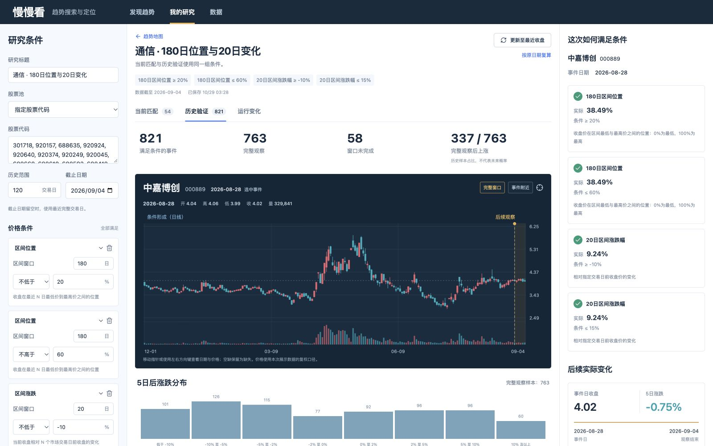

# 趋势筛选与研究验证

## 从一个明确问题开始

`kan web` 默认打开趋势筛选。选择连续上涨、连续下跌、先跌后涨、先涨后跌、区间涨跌天数或形态检索，明确填写参数后才执行。初始没有天数、筛选策略或股票推荐，允许显式浏览整个股票池。

当前筛选只计算指定截止日的匹配和图证，不生成 Study，也不计算历史事件。结果表格、地图、连续段、本段变化和多周期位置使用同一份事实。先选行业时，先缩小完整股票范围，再逐股判断，不只保留恰好有数据或匹配的对象。

| 条件 | 精确含义 |
|---|---|
| 连续收盘上涨 / 下跌 | 连续市场交易日收盘严格高于 / 低于前收；平盘与缺行中断 |
| 连续阳线 / 阴线 | 收盘严格高于 / 低于当日开盘；十字线与缺行中断 |
| 先跌后涨 / 先涨后跌 | 当前段与紧邻前一相反段分别符合天数条件，不跨平盘或缺口寻找更早一段 |
| 最近 N 日上涨 / 下跌次数 | 最近 N 个市场交易日逐日收盘变化的计数，需 N+1 个完整收盘，平盘不计；可以查询零次 |
| 至少 / 恰好 / 最多 N 天 | 连续段“最多”是 1–N 天，不包含反方向的零天 |

数据窗口开头或缺口之后的连续段可能只有下界；显示“至少”，不能据此断言恰好或最多。方向判定使用原始数值，不先四舍五入；本段价格变化使用端点比值，不把每日百分比相加。

## 同一结果的地图与位置

地图只展示当前匹配对象；选择截止日、位置窗口与涨跌窗口后，所有可绘制对象使用同一日期。横轴是收盘在最近 N 日最高/最低价之间的位置，纵轴是相对 N 个市场交易日前收盘的涨跌。

常用位置窗口为 30/60/180 日，涨跌窗口为 5/20/60 日，同次结果返回，切换显示不重新扫描全市场。短期条件可能可判断而长期位置缺失，地图单独标明可定位对象，不把长期缺口变成条件失败。

缺少完整窗口、截止日行情或本地缓存的股票计入缺口；不会用另一日期的数据代入，也不会填成 0。当前 A 股身份来自当前上市名单，行业归属也是当前口径。

TuShare 日线使用原始 `daily` 与 `adj_factor`，同一股票的整个窗口按同一截止日因子计算复权价格。旧的逐日 qfq 拼接缓存缺少统一基准，不继续读取；显式更新行情后重建，已有研究、持仓和凭据不会因此删除。

## 圈定区域，形成研究

桌面可以显式进入框选模式；手机或键盘用户可以直接在附加条件中填写位置与区间涨跌上下界。选区回填成可见条件，点击筛选后才更新结果。核对历史时使用原完整范围，不把当前匹配对象误当历史股票池。

默认不建立条件组合。条件字段、窗口、比较符和数值必须明确，全部条件按 AND 组合。`kan study catalog` 给出实时字段与定义，`kan study schema` 给出完整输入契约。

位置与收益来自同一 `calculate_metrics`；前端不通过自己的公式重新判断匹配。

## 按需核对历史



点击“核对历史”后确认回看范围、事件采样和后续窗口，再执行并保存。历史研究与当前筛选共用指标，运行后取得：

- 指定截止日的当前匹配，以及因资料不足无法判断的对象。
- 历史股票日的可用、可评估与原始命中数量。
- 按首次满足、每次满足或不重叠规则选出的事件。
- 事件后观察窗口完整、尚未成熟、应有行情缺失三类数量。
- 完整样本的实际涨跌分布、分位与逐事件证据。

“首次满足”需要前一个市场交易日明确不满足；缺行后不能凭空断言出现了一次新事件。连续段在数据开头或缺口后可能只知道长度下界，此时不能据此断言“恰好 N 天”。

后续窗口按市场交易日定位，停牌或缓存缺行不会被压缩成连续行情日。完整统计基于全部事件；列表分页不会改变统计分母。

## 形态检索

参照来自用户明确选择的股票、日期与窗口。每段收盘序列按首日归一到 100，形态距离为对应各日差的均方根，单位是百分点。阈值由用户填写，不内置“最好股票”评分。

参照窗口与候选窗口都必须完整。同股票、同日期的自匹配单列排除。参照行情随运行保存，图证不会受到之后缓存刷新的影响。

如果参照形态晚于历史事件，这是一种事后形态检索：可描述“过去哪些形状相近、后来怎样”，不能证明当时可以提前选择它们，也不能称为策略回测。

## 保存与继续研究

“保存筛选”只保存名称与查询，载入后可以继续修改或重新筛当前，不读取行情或创建历史研究。研究执行后才自动留存定义和结果。SQLite 存轻量状态、摘要、索引与参照，命中对象的当次行情和完整事件放在独立 Parquet 中。点击历史样本读取当次事实，不读取新缓存冒充旧结果。

固定日期的研究可“按原日期复算”。“更新至最近收盘”是显式改变截止日的动作，保持条件与形态参照，保存新运行并比较当前命中新增、移出和数据不可用。数据丢失不会被解释为不再符合条件。

```bash
kan trend --universe all --down-days 5 --format json
kan trend --universe all --up-days 3 --comparison eq
kan trend --universe all --up-days 2 --previous-down-days 3
kan trend --universe all --rising-days 8 --window 10
kan study run query.json --format json
kan study list --format json
kan study show <study_id> --format json
kan study rerun <study_id> --latest --format json
```

## 数据更新与入口

数据页支持明确的全市场、个人池或代码范围更新。获取日数与本次研究需要的历史窗口应匹配；代码更新不会扩大成全市场，个人池包括已有自选、持仓与人工候选。任务状态、部分失败和数据缺口保持可见。

Web 当前入口为趋势筛选、研究记录和数据工具；当前结果提供保存筛选、形态检索与显式历史研究。请求日期无可判断行情时，分别显示缺口和本地主要数据日期；只有点击对应按钮才改日期，不静默回退。

TUI 可直接填条件与范围，Enter 或 Ctrl+Enter 执行；`f` 编辑、`m` 看缺口、Enter 查日线、`s` 保存、`g` 载入、`h` 配置并核对历史。`l` 查看研究，`1/2` 切换当前/历史，`n/p` 翻页，Esc 返回。

HTTP 当前接口由 `/api/v1/openapi.json` 描述，当前筛选为 `/trends/search`、`/trends/search/evidence`、`/trends/saved`；历史为 `/studies` 系列。MCP `kan_trend` 与 Python `search_trends` 直接使用同一 Query/Result。旧 CLI 参数与旧页面不保留兼容别名；已有用户数据与凭据不会因页面移除而删除。

## 解释边界

当前上市名单的历史分析是当前股票池回溯，不能冒充历史全市场。来源日线的复权处理和本次输入序列随结果标注；相对指标在同一输入中计算。价格分布不是成交收益，样本上涨占比不是未来概率。当前不支持分钟事件；缺失分钟不能用日线猜测。
